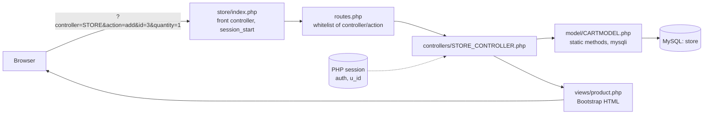
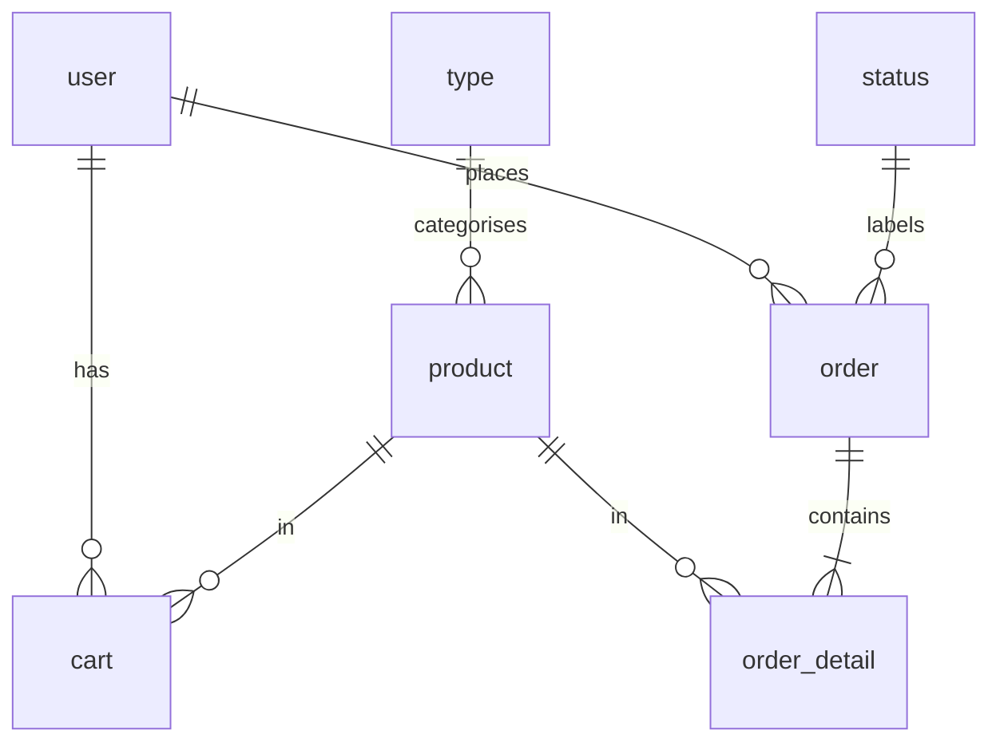

# Banana Store

A small Thai-language web store for gadgets (notebooks, phones, tablets, accessories) with user accounts, a cart, search, an order-status pipeline, ratings, and an admin page for moving orders through that pipeline. "Banana" is the shop's brand: a cartoon-banana logo (`store/views/img/HOME.png`), a yellow theme, and a seeded catalogue whose images are pulled from the CDN of BaNANA IT, a Thai electronics retailer. No bananas are sold.

Stack: plain PHP (no framework) with `mysqli`, Bootstrap 5.2.3 and Font Awesome 4.7 from CDNs, MySQL/MariaDB.

## What it does

| Feature | Who uses it | Where in code |
|---|---|---|
| Browse "best sellers" (products sorted by `p_rating`), by category, or by name search (`LIKE '%term%'`) | Visitor | `STORE_CONTROLLER::index_STORE/type/search`, `model/PRODUCTMODEL.php` |
| Register and log in (session based) | Visitor | `views/register.php`, `views/login.php` |
| Add to cart, buy now, remove item, place order | Logged-in user | `STORE_CONTROLLER::add/buy/delete/order`, `model/CARTMODEL.php`, `model/ORDERMODEL.php` |
| Account page with per-status counts, order history, pay, track shipping, confirm receipt, rate 1-5 | Logged-in user | `STORE_CONTROLLER::user/history/pay/paid/ship/receive/received/rating/ratingConfirm` |
| See every order and change its status from a dropdown | Admin | `admin.php`, `ADMIN_CONTROLLER::index/update`, `views/index_admin.php` |

Order statuses are rows in the `status` table: 1 awaiting payment, 2 awaiting verification, 3 preparing, 4 in transit, 5 delivered, 6 to be rated, 7 complete. The user moves 1->2 (`paid`), 5->6 (`received`) and 6->7 (`ratingConfirm`); the admin sets anything else.

## Architecture



Everything hangs off two front controllers in `store/`: `index.php` for shoppers and `admin.php` for the admin, which both read `?controller=` and `?action=` from the query string and `require` `routes.php`. `routes.php` holds a hard-coded array of allowed actions per controller, requires the matching `controllers/<NAME>_CONTROLLER.php` plus the models it needs, and calls `$controller->{$action}()`. For "add to cart", `STORE_CONTROLLER::add()` reads `u_id` and `auth` from `$_SESSION`, calls `CART::add()`, which opens a connection via `connection_connect.php`, runs an `INSERT INTO cart`, closes it via `connection_close.php`, and the controller then `require_once`s `views/product.php` to render the page. Views are plain PHP templates; `index.php` wraps them with a shared Bootstrap `<head>` and fixed navbar. Login and register are standalone pages under `views/` that run their own SQL and set `$_SESSION['auth']` and `$_SESSION['u_id']`.

## Repository layout

```
database/store.sql            phpMyAdmin dump: schema, FKs, seed data (8 products, 1 user, 1 admin)
store/
  index.php                   shopper front controller + navbar; starts the session
  admin.php                   admin front controller + red navbar; no session or auth check
  routes.php                  action whitelist, model loading, dispatch
  connection_connect.php      new mysqli(host, user, password, database); set_charset utf8
  connection_close.php        $conn->close()
  controllers/
    STORE_CONTROLLER.php      catalogue, cart, orders, account, logout
    ADMIN_CONTROLLER.php      order list, status update, logout
  model/                      one class per table, static methods returning objects
    PRODUCTMODEL.php  CARTMODEL.php  USERMODEL.php
    ORDERMODEL.php    ORDER_DETAILMODEL.php  STATUSMODEL.php
  views/                      PHP templates (Thai UI); login/register/login_admin are standalone
    Best_Seller.php index_STORE.php product.php cart.php user.php history.php
    pay.php ship.php receive.php rating.php index_admin.php
    login.php register.php login_admin.php img/HOME.png
```

## Run locally

Prerequisites: PHP 7.4+ with the `mysqli` extension (the dump was taken on PHP 8.1.10 / MariaDB 10.4.25, i.e. a XAMPP-style setup), MySQL or MariaDB, and either Apache or PHP's built-in server. The web root must be the `store/` directory, because `index.php` requires `routes.php` relatively and the login pages require `../connection_connect.php`.

```sh
mysql -u root -p -e "CREATE DATABASE store CHARACTER SET utf8mb4"
mysql -u root -p store < database/store.sql
# edit the four positional arguments of new mysqli(...) in store/connection_connect.php: host, user, password, database
php -S localhost:8000 -t store
open http://localhost:8000/            # shop
open http://localhost:8000/admin.php   # admin (log in first at /views/login_admin.php)
```

`store.sql` seeds one shopper (`u_id` = `user`) and one admin (`ad_id` = `admin`); their passwords are in the dump, stored in plaintext. Change them before exposing the app anywhere.

## Routes

All shopper routes are `index.php?controller=STORE&action=<action>`; admin routes are `admin.php?controller=ADMIN&action=<action>`. "Checked" means the controller verifies `$_SESSION['auth']`; "session" means it reads `$_SESSION['u_id']` without checking it.

| Action | Controller method | Params | Auth |
|---|---|---|---|
| `index_STORE` (default) | `STORE::index_STORE` | - | no |
| `type`, `search`, `product` | `STORE::type/search/product` | `id` / `search` / `id` | no |
| `add`, `buy` | `STORE::add/buy` | `id`, `quantity` | checked |
| `cart` | `STORE::cart` | - | checked |
| `delete` | `STORE::delete` | `id` (product) | session |
| `order` | `STORE::order` | - | session |
| `user`, `history`, `pay`, `ship`, `receive`, `rating` | `STORE::<same>` | - | session |
| `paid`, `received` | `STORE::paid/received` | `id` (order) | session |
| `ratingConfirm` | `STORE::ratingConfirm` | `id`, `rating` | session |
| `logout` | `STORE::logout` | - | no |
| `index` (admin default) | `ADMIN::index` | - | none |
| `update` | `ADMIN::update` | `o_id`, `s_id` | none |
| `logout` | `ADMIN::logout` | - | none |

Standalone pages: `views/login.php`, `views/register.php`, `views/login_admin.php` (POST to themselves). Unknown controller/action falls through to `call('page','error')`, but no `page_CONTROLLER.php` exists, so with `error_reporting(0)` the result is a blank page.

## Data model

Tables in `database/store.sql` (all InnoDB, utf8/utf8mb4):

- `user` - `u_id` (PK, username), `u_email`, `u_address`, `u_pass` (plaintext, varchar 15)
- `admin` - `ad_id` (PK), `ad_pass` (int)
- `type` - `t_id`, `t_name` (Notebook, Smartphone, Tablet, Accessories)
- `product` - `p_id`, `t_id` FK, `p_img` (URL), `p_name`, `p_detail`, `p_price`, `p_rating`
- `cart` - `c_id`, `u_id` FK, `p_id` FK, `c_quantity`
- `order` - `o_id`, `u_id` FK, `s_id` FK, `o_rating`
- `order_detail` - `od_id`, `o_id` FK, `p_id` FK, `c_quantity`
- `status` - `s_id`, `s_name` (the seven Thai status labels)



## Status

University coursework from April 2023, and my first full web app in plain PHP. The shopper flow works end to end: register, log in, browse, search, cart, order, pay, track, receive, rate. The admin page moves any order through the seven statuses.

It is a learning project and was never hardened for the open internet. Queries are built with string interpolation rather than prepared statements, passwords are not hashed, the admin page relies on obscurity instead of a session check, and DB credentials live in `connection_connect.php`. Run it locally only.

If I rewrote it today: prepared statements everywhere, `password_hash`, a real admin login with session checks, every cart and order query scoped to the signed-in user, credentials in an ignored config file, and `htmlspecialchars` on output. Most of that is what the later Go and Spring Boot projects on this profile do.
